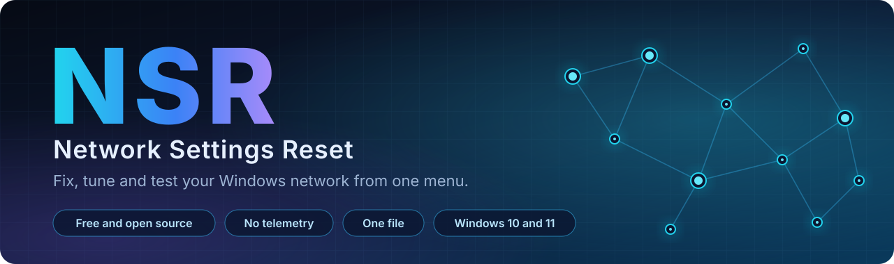
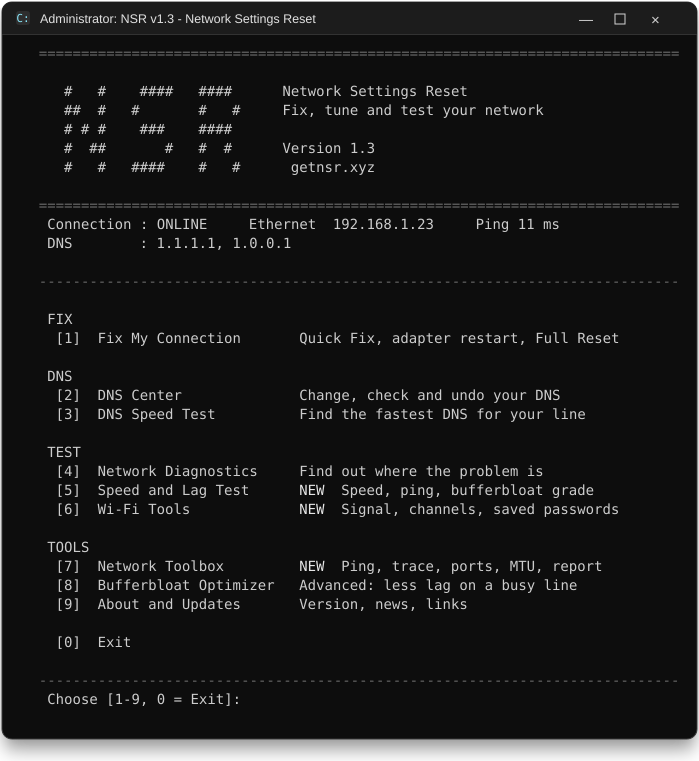
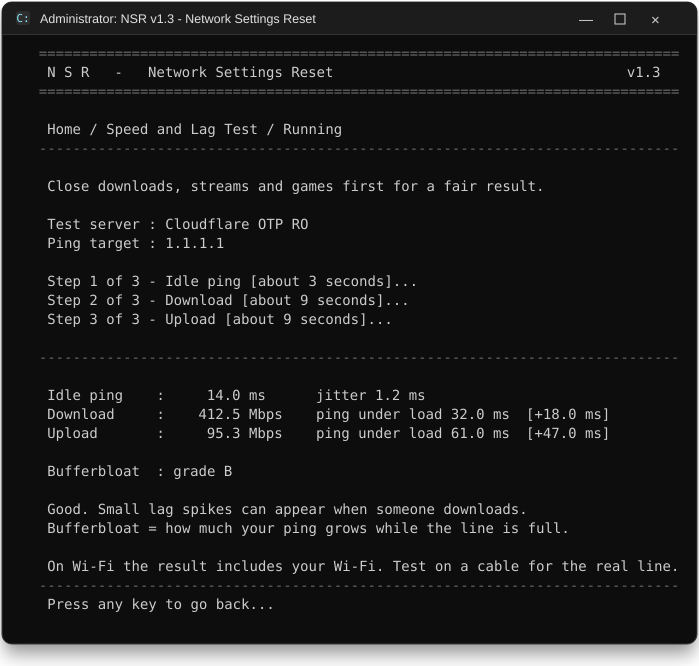
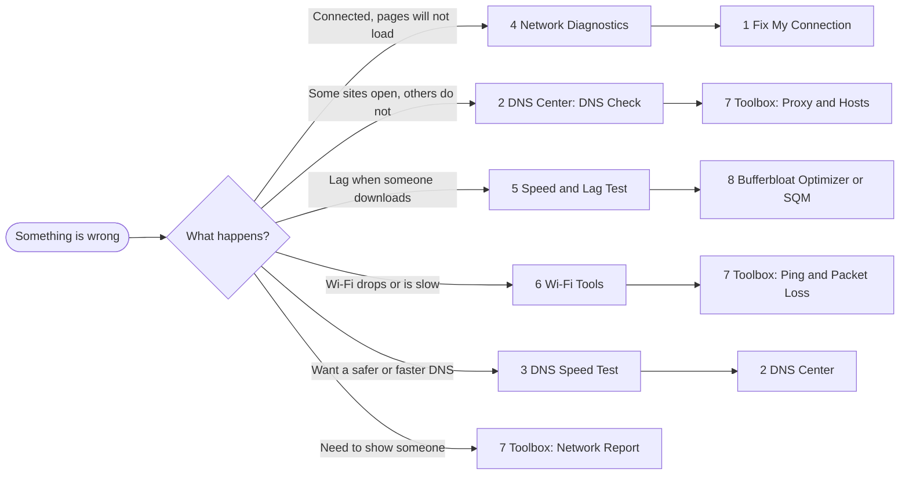

<div align="center">



<br>

[](https://github.com/M1HA1586/Network-Settings-Reset/releases/latest)
[](#-license)


### Repair your connection. Change DNS. Test speed and lag. Find what is wrong.
**One file. No installer. You only press number keys.**

<br>

[](https://github.com/M1HA1586/Network-Settings-Reset/releases/latest/download/NSR.bat)

[**Features**](#-features) &nbsp;•&nbsp; [**Quick start**](#-quick-start) &nbsp;•&nbsp; [**Where to start**](#-where-to-start) &nbsp;•&nbsp; [**Safety**](#%EF%B8%8F-safety) &nbsp;•&nbsp; [**FAQ**](#-faq) &nbsp;•&nbsp; [**Website**](https://getnsr.xyz) &nbsp;•&nbsp; [**Guides**](https://getnsr.xyz/guides/)

</div>

<br>

## 👀 See it in action

<div align="center">



<sub>The real NSR menu. The address, DNS and ping shown are sample values.</sub>

</div>

<br>

## 💡 Why NSR

<table>
<tr>
<td width="25%" valign="top">

### 🎛️ Simple
Same keys on every screen. Number keys choose, `0` always goes back.

</td>
<td width="25%" valign="top">

### 📖 Readable
One plain text file. Open it in Notepad and read every command first.

</td>
<td width="25%" valign="top">

### ↩️ Reversible
Undo for DNS, backup for the hosts file, restore for the tweaks.

</td>
<td width="25%" valign="top">

### 🕊️ Private
No telemetry, no account, nothing installed. Close the window and NSR is gone.

</td>
</tr>
</table>

<br>

## 🚀 Quick start

<table>
<tr>
<td align="center" width="33%"><h3>1️⃣ Download</h3>Get <a href="https://github.com/M1HA1586/Network-Settings-Reset/releases/latest/download/NSR.bat"><code>NSR.bat</code></a>.<br>One file, about 89 KB.</td>
<td align="center" width="33%"><h3>2️⃣ Run</h3>Double-click it and click <b>Yes</b><br>when Windows asks for permission.</td>
<td align="center" width="33%"><h3>3️⃣ Press a key</h3>Pick a tool with the number keys.<br><code>0</code> always goes back.</td>
</tr>
</table>

Or download it with PowerShell:

```powershell
Invoke-WebRequest "https://github.com/M1HA1586/Network-Settings-Reset/releases/latest/download/NSR.bat" -OutFile "$env:USERPROFILE\Downloads\NSR.bat"
```

> [!NOTE]
> Windows may say **"Windows protected your PC"**. NSR is not digitally signed, so SmartScreen warns for any downloaded script. Click **More info**, then **Run anyway**. Read the file in Notepad first if you want to check it.

**⬆️ Updating:** download the new `NSR.bat` and replace the old one. Your `NSR_Backup` folder stays as it is. You can also press `9`, then `3` (Check for Updates) inside NSR. It asks GitHub only when you choose it.

<br>

## ✨ Features

Nine tools in one menu, grouped by what you want to do.

<table>
<tr>
<td width="33%" valign="top">

**🛠️ 1 · Fix My Connection**<br>
Quick Fix, Restart Adapters or Full Reset. Three levels, from safe to strong.

</td>
<td width="33%" valign="top">

**🔒 2 · DNS Center**<br>
20 providers on IPv4 and IPv6, encrypted DNS on Windows 11, Undo Last Change and DNS Check.

</td>
<td width="33%" valign="top">

**🏁 3 · DNS Speed Test**<br>
Ranks all 20 providers on your own line and offers to apply the winner.

</td>
</tr>
<tr>
<td width="33%" valign="top">

**🩺 4 · Network Diagnostics**<br>
Finds the problem in about ten seconds: router, Internet, IPv6, DNS or web access.

</td>
<td width="33%" valign="top">

**⚡ 5 · Speed and Lag Test** `NEW`<br>
Download, upload, ping, jitter and a bufferbloat grade from A+ to F.

</td>
<td width="33%" valign="top">

**📶 6 · Wi-Fi Tools** `NEW`<br>
Signal, crowded channels, best channel, saved passwords and the Wi-Fi history report.

</td>
</tr>
<tr>
<td width="33%" valign="top">

**🧰 7 · Network Toolbox** `NEW`<br>
Ping, trace route, ports, connections, proxy, hosts, MTU and a report for support.

</td>
<td width="33%" valign="top">

**🧪 8 · Bufferbloat Optimizer**<br>
Advanced tweaks for lag on a busy line, with backup and restore.

</td>
<td width="33%" valign="top">

**ℹ️ 9 · About and Updates**<br>
Version, news, links, update check and your backup folder.

</td>
</tr>
</table>

### ⚡ Speed and Lag Test

Most speed tests only tell you how fast the line is. NSR also measures your ping **while the line is busy** and grades the difference. That grade is called bufferbloat, and it is why games lag when someone downloads.

<div align="center">



<sub>A sample result. Results are saved, so you can compare before and after a change.</sub>

</div>

| Grade | Added ping under load | Meaning |
| :---: | :---: | --- |
| **A+** | under 5 ms | Excellent. Stays low even when the line is busy |
| **A** | under 30 ms | Very good. Games and calls stay smooth |
| **B** | under 60 ms | Good. Small lag spikes when someone downloads |
| **C** | under 200 ms | Noticeable lag. Smart Queue (SQM) on the router helps most |
| **D** | under 400 ms | Heavy lag. SQM on the router is the best fix |
| **F** | 400 ms or more | Severe lag. SQM on the router is the best fix |

> [!WARNING]
> The test moves data for about 20 seconds: roughly 200 MB on a 100 Mbps line, over 1 GB on a very fast one. Do not run it on mobile data.

<details>
<summary><b>🔒 DNS Center and the 20 providers</b></summary>

<br>

- Change DNS on **IPv4 and IPv6**, with **encrypted DNS (DoH)** on Windows 11.
- **Undo Last Change** puts your old DNS back. **Reset to Automatic** uses your router or ISP DNS.
- **DNS Check** shows which DNS server really asks the Internet and tests if your DNS rewrites answers for names that do not exist.

| Group | Provider | Primary IPv4 | |
| --- | --- | --- | --- |
| ⚡ Fast | Cloudflare | `1.1.1.1` | Fast, privacy focused |
| ⚡ Fast | Google | `8.8.8.8` | Very popular and reliable |
| ⚡ Fast | Cisco OpenDNS | `208.67.222.222` | Stable, has filter options |
| ⚡ Fast | GCore | `95.85.95.85` | Alternative provider |
| 🕶️ Private | DNS.SB | `185.222.222.222` | No filtering, DNSSEC |
| 🕶️ Private | Control D | `76.76.2.0` | Free, no filtering |
| 🕶️ Private | Mullvad | `194.242.2.2` | Privacy focused, Sweden |
| 🕶️ Private | DNS4EU Unfiltered | `86.54.11.100` | European, no filtering |
| 🕶️ Private | UncensoredDNS | `91.239.100.100` | Danish, no filtering |
| 🛡️ Safe | Quad9 | `9.9.9.9` | Non-profit, no personal logs |
| 🛡️ Safe | Cloudflare Security | `1.1.1.2` | Fast, blocks malware |
| 🛡️ Safe | DNS4EU Protective | `86.54.11.1` | European, blocks threats |
| 🛡️ Safe | CleanBrowsing Security | `185.228.168.9` | Blocks malware, phishing |
| 🛡️ Safe | Mullvad Base | `194.242.2.4` | Blocks ads, trackers, malware |
| 👨‍👩‍👧 Ads and family | AdGuard DNS | `94.140.14.14` | Blocks ads, trackers, malware |
| 👨‍👩‍👧 Ads and family | AdGuard Family | `94.140.14.15` | Also blocks adult sites |
| 👨‍👩‍👧 Ads and family | Mullvad Adblock | `194.242.2.3` | Blocks ads and trackers |
| 👨‍👩‍👧 Ads and family | DNS4EU Ads Block | `86.54.11.13` | European, blocks threats, ads |
| 👨‍👩‍👧 Ads and family | Control D Family | `76.76.2.4` | Blocks adult sites, malware |
| 👨‍👩‍👧 Ads and family | CleanBrowsing Family | `185.228.168.168` | Strict, blocks adult sites |

Secondary and IPv6 addresses are on the [DNS servers page](https://getnsr.xyz/dns/).

</details>

<details>
<summary><b>🧰 The 9 tools in the Network Toolbox</b></summary>

<br>

| | Tool | What it does |
| :---: | --- | --- |
| 🏓 | **Ping and Packet Loss** | 30 pings to your router, Cloudflare, Google or any host, with jitter and loss |
| 🛣️ | **Trace Route** | Shows where the connection slows down |
| 🔌 | **Port Checker** | Is a TCP port open, closed or blocked? |
| 👀 | **Active Connections** | Which programs use the Internet right now |
| 🕵️ | **Proxy and VPN Check** | Finds proxies and VPN adapters, can turn the proxy off |
| 📄 | **Hosts File** | Shows entries, opens the file, resets it with a backup |
| 📏 | **Best MTU** | Finds the best packet size for your line, can set it and go back to 1500 |
| 🧾 | **Network Report** | One text file on your Desktop for your ISP or a friend who helps you |
| 💻 | **PC Information** | CPU, RAM, GPU, disks and network |

</details>

<details>
<summary><b>📶 What the Wi-Fi Tools do</b></summary>

<br>

- 📡 **This Connection:** signal, speed and details of your Wi-Fi.
- 🔍 **Nearby Networks:** how crowded each channel is, and the least crowded 2.4 GHz channel.
- 🔑 **Saved Passwords:** the Wi-Fi passwords stored on your own PC.
- 📜 **History Report:** the Windows Wi-Fi report with disconnects and errors.

On Windows 11, Windows lets programs read Wi-Fi details only when **Location services** are on. NSR explains this and offers to open the setting. It does not use or store your location.

</details>

<details>
<summary><b>🛠️ The three levels of Fix My Connection</b></summary>

<br>

| Level | What it does |
| --- | --- |
| **1 · Quick Fix** | Flushes DNS, clears ARP, renews the IP address |
| **2 · Restart Adapters** | Quick Fix and a restart of the network cards |
| **3 · Full Reset** | Quick Fix and a reset of Winsock and TCP/IP. Needs a restart |

Start with the lowest level.

</details>

<br>

## 🧭 Where to start

Not sure which tool to open? Start from the problem.



<br>

## ✅ Requirements

| | |
| --- | --- |
| 🪟 **Windows** | Windows 10 or 11 |
| 💠 **PowerShell** | 5.1 or newer. Windows already includes it |
| 🛡️ **Rights** | Administrator. NSR asks for them by itself |
| 🔐 **Encrypted DNS (DoH)** | Windows 11 only. On Windows 10 NSR sets normal DNS |
| 📍 **Wi-Fi details** | On Windows 11, Location services must be on |
| 🌐 **Internet** | Only for the speed test, the DNS speed test and the update check |

<br>

## 🛡️ Safety

NSR changes system and network settings, so here is exactly what it touches. **Everything that writes asks you first.**

| Feature | What it changes | How to undo |
| --- | --- | --- |
| Fix My Connection | Caches, IP renewal, adapters, Winsock and TCP/IP (Full Reset) | Quick Fix: nothing to undo. Full Reset needs a restart |
| DNS Center | DNS on every active physical adapter | **Undo Last Change**, or Reset to Automatic |
| Proxy and VPN Check | Can turn off the manual proxy and the WinHTTP proxy | Set the proxy again in Windows Settings |
| Hosts File | Can reset the file to the Windows default | Backup saved in `NSR_Backup` |
| Best MTU | Can set the MTU of active adapters | Back to Windows Default (1500) |
| Bufferbloat Optimizer | Registry values, TCP settings, card offloads | Restore Windows Defaults, then restart |
| Everything else | **Nothing. It only reads.** | - |

<details>
<summary><b>🌍 What NSR contacts</b></summary>

<br>

NSR has no server of its own. These are the only places it talks to, and only when the feature runs.

| Feature | Talks to |
| --- | --- |
| Main screen status | `1.1.1.1` (ping, then port 443 if ping is blocked) |
| Network Diagnostics | Your router, `1.1.1.1`, IPv6, `example.com`, `www.cloudflare.com` |
| DNS Check | `whoami.akamai.net`, `o-o.myaddr.l.google.com` and a random name that cannot exist |
| DNS Speed Test | The 20 DNS providers |
| Speed and Lag Test | `speed.cloudflare.com` and `1.1.1.1` |
| Check for Updates | `api.github.com`, only when you choose it |
| Ping, Trace Route, Port Checker | The host you type |

</details>

<details>
<summary><b>💾 What NSR keeps on your PC</b></summary>

<br>

Everything is in `%USERPROFILE%\NSR_Backup`. You can open the folder from About and Updates.

| File | Content |
| --- | --- |
| `NSR_log.txt` | What NSR did and when |
| `DNS_before.txt` | Readable copy of your DNS before each change |
| `DNS_last.json` | Used by Undo Last Change |
| `SpeedTests.txt` | Your speed and lag test results |
| `hosts_backup_*.txt` | Copy of the hosts file before a reset |
| `*.reg` | Registry backups from the Bufferbloat Optimizer |

</details>

> [!CAUTION]
> *Saved Passwords* prints passwords on the screen, so use it only on your own PC. The *Network Report* contains your IP addresses and network name, so read it before you share it. If you are not sure about a tweak, create a Windows restore point first.

More: [Is NSR safe?](https://getnsr.xyz/safety/)

<br>

## ❓ FAQ

<details>
<summary><b>Is NSR a virus?</b></summary>

<br>

No. It is a plain text batch file, open source under the MIT License. Windows may warn you because it is not digitally signed. Read it in Notepad if you want to check.

</details>

<details>
<summary><b>Does NSR collect my data?</b></summary>

<br>

No. It has no telemetry and no account. The few features that talk to public servers are listed in the Safety section, and only when you run them.

</details>

<details>
<summary><b>I am connected but there is no Internet. What do I do?</b></summary>

<br>

Run **Network Diagnostics** (`4`) to see if the router, the Internet or DNS is the problem. Then use **Fix My Connection** (`1`), starting with Quick Fix.

</details>

<details>
<summary><b>A site is blocked on only one PC. What do I check?</b></summary>

<br>

Open the **Network Toolbox** (`7`) and look at **Proxy and VPN Check** and **Hosts File**. A proxy or a line in the hosts file can block sites. Also check your DNS: a Safe or Family provider blocks sites on purpose.

</details>

<details>
<summary><b>How do I undo a DNS change?</b></summary>

<br>

**DNS Center** (`2`), then **Undo Last Change** (`4`) puts back your old DNS. **Reset to Automatic** (`3`) uses your router or ISP DNS.

</details>

<details>
<summary><b>Which DNS should I choose?</b></summary>

<br>

- Fast and simple: Cloudflare or Google
- Privacy, nothing blocked: Mullvad, DNS.SB or Control D
- Safer, blocks malware: Quad9, Cloudflare Security or DNS4EU Protective
- Fewer ads and trackers: AdGuard DNS
- Kids' PC: AdGuard Family or CleanBrowsing Family

Or run the **DNS Speed Test** and see what is fastest on your line.

</details>

<details>
<summary><b>The encrypted DNS question did not appear.</b></summary>

<br>

Encrypted DNS (DoH) needs Windows 11, and not every provider supports it (GCore does not). On Windows 10, NSR sets normal DNS.

</details>

More answers on the [FAQ page](https://getnsr.xyz/faq/).

<br>

## 📚 Guides

Prefer to do it by hand? Each guide has real commands and also shows the one-key way in NSR.

| | |
| --- | --- |
| [Fix "No Internet" on Windows 10 and 11](https://getnsr.xyz/guides/fix-no-internet-windows/) | [Change DNS on Windows](https://getnsr.xyz/guides/change-dns-windows/) |
| [Flush DNS and reset Winsock](https://getnsr.xyz/guides/flush-dns-reset-winsock/) | [Best DNS servers](https://getnsr.xyz/guides/best-dns-servers/) |
| [Bufferbloat and lag](https://getnsr.xyz/guides/bufferbloat-windows/) | [Find the best Wi-Fi channel](https://getnsr.xyz/guides/wifi-slow-best-channel/) |
| [Test ping, jitter and packet loss](https://getnsr.xyz/guides/ping-test-packet-loss-windows/) | [Check and reset the hosts file](https://getnsr.xyz/guides/reset-hosts-file-windows/) |
| [Find the best MTU](https://getnsr.xyz/guides/best-mtu-windows/) | [Check if a port is open](https://getnsr.xyz/guides/check-open-port-windows/) |

All guides: [getnsr.xyz/guides](https://getnsr.xyz/guides/)

<br>

## 🆕 What's new in v1.3

The biggest update since v1.0.

- 🎛️ One set of keys on every screen, and menus grouped into FIX, DNS, TEST and TOOLS
- 📊 New main screen with a live status panel
- ⚡ New **Speed and Lag Test** with a bufferbloat grade
- 📶 New **Wi-Fi Tools**
- 🧰 New **Network Toolbox** with 9 tools
- ↩️ **Undo Last Change** and **DNS Check** in the DNS Center
- 🔄 **Restart Adapters** level in Fix My Connection

Full notes: [Changelog](https://getnsr.xyz/changelog/) · [Releases](https://github.com/M1HA1586/Network-Settings-Reset/releases)

<br>

## 🤝 Help the project

- 🐞 **Found a bug or a wrong address?** [Open an issue](https://github.com/M1HA1586/Network-Settings-Reset/issues).
- 🔐 **Security problem?** Please report it [privately](https://github.com/M1HA1586/Network-Settings-Reset/security/advisories/new).
- ⭐ **Star the repo.** It takes a second and helps other people find NSR.
- 📤 **Share it** with a friend who always asks you to fix their Wi-Fi.
- ☕ **Support it.** NSR is built and maintained by one person, for free, with no ads and no tracking. [Say thanks with a coffee](https://getnsr.xyz/support/).

<br>

## 📄 License

Released under the **MIT License**.

<div align="center">

<br>

**Made by [M1HA1586](https://github.com/M1HA1586)** &nbsp;·&nbsp; [getnsr.xyz](https://getnsr.xyz)

<sub>NSR is not affiliated with Microsoft, Cloudflare, Google or any DNS provider named here.<br>NSR changes system and network settings. Use it at your own risk.</sub>

[⬆ Back to top](#)

</div>
