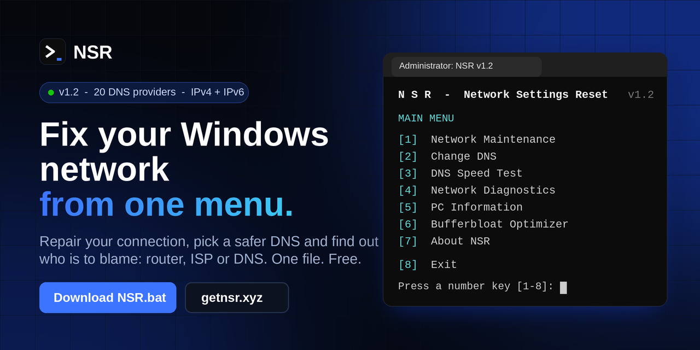

<div align="center">

<a href="https://getnsr.xyz"></a>

<br>

[](https://github.com/M1HA1586/Network-Settings-Reset/releases/latest/download/NSR.bat)
[](https://getnsr.xyz)
[](https://github.com/M1HA1586/Network-Settings-Reset/releases/latest)
[](LICENSE)

**One file. One menu. Press a number key and your Windows network is fixed.**
Repair the connection, pick a safer DNS from 20 providers, test DNS speed and find out if the problem is your router, your ISP or DNS.

[🌐 Website](https://getnsr.xyz) · [✨ Features](#features) · [🛡️ DNS](#dns) · [🚀 Quick Start](#quick-start) · [📚 Guides](#guides) · [🔐 Trust](#trust) · [❓ FAQ](#faq) · [💖 Support](#support)

</div>

---

<a id="why"></a>
## 💡 Why NSR

| 📦 One file | 🔒 No telemetry | 👀 Fully open | ↩️ Reversible |
|:-:|:-:|:-:|:-:|
| No installer, no extra downloads | No account, nothing about you is sent | Plain text. Read every line first | DNS and tweaks undo from the menu |

---

<a id="preview"></a>
## 👀 Preview

> This is the real menu. The [website](https://getnsr.xyz) has a live demo you can click.

```
  ============================================================================
   N S R   -   Network Settings Reset                                 v1.2
  ============================================================================

   MAIN MENU
  ----------------------------------------------------------------------------

   Administrator: YES     PowerShell: 5.1.26100.1     Windows build: 26100

   [1]  Network Maintenance      Fix connection problems (recommended)
   [2]  Change DNS               Faster, safer or family-friendly DNS
   [3]  DNS Speed Test           Find the fastest DNS for your line
   [4]  Network Diagnostics      Find out where the problem is
   [5]  PC Information           CPU, RAM, GPU, disks, network
   [6]  Bufferbloat Optimizer    Advanced: less lag when the line is busy
   [7]  About NSR                Version, what's new, links

   [8]  Exit
```

---

<a id="whats-new"></a>
## 🆕 What's new in v1.2

| | |
|:-:|---|
| 🛡️ | **20 DNS providers in 4 groups:** fast, private, safe, and ads and family |
| ➕ | **New:** DNS.SB, Control D, Mullvad, UncensoredDNS, CleanBrowsing and more DNS4EU profiles |
| ⚡ | **DNS Speed Test** tests all 20, shows progress `[3/20]` and ranks them |
| 🔒 | The DNS screen shows **`[DoH]`** when encrypted DNS is on |
| 💾 | **Your old DNS is saved** to `NSR_Backup\DNS_before.txt` before every change |
| 🔄 | **Check for updates** inside About NSR |
| ⚠️ | Strict providers tell you what they block before you apply them |

Full list: [Releases](https://github.com/M1HA1586/Network-Settings-Reset/releases).

---

<a id="features"></a>
## ✨ Features

| | Option | What it does |
|:-:|---|---|
| 🛠️ | **Network Maintenance** | Quick Fix or Full Reset. Every step shows OK or FAIL, and the connection is tested at the end |
| 🔀 | **Change DNS** | Pick one of 20 providers or enter your own (IPv4 and IPv6). Go back to automatic anytime |
| 📡 | **DNS Speed Test** | Real DNS requests to every provider, compared with your current DNS, then apply the fastest |
| 🩺 | **Network Diagnostics** | Checks router, Internet (IPv4 and IPv6), DNS and web access, then tells you who is to blame |
| 💻 | **PC Information** | CPU, RAM, GPU, mainboard, disks, uptime, IPv4 and IPv6 address |
| 🎮 | **Bufferbloat Optimizer** | Advanced tweaks for less lag when the line is busy, with backup and restore |
| ℹ️ | **About NSR** | Version, what's new, update check, links and the backup / log folder |

### 🩺 Network Diagnostics

```
   Adapter        : Ethernet  1 Gbps
   Local IPv4     : 192.168.1.23
   Gateway        : 192.168.1.1

   Router (gateway)       [ OK ]  2 ms
   Internet IPv4          [ OK ]  11 ms
   Internet IPv6          [ OK ]  12 ms
   DNS lookup             [ OK ]  9 ms
   Web access (HTTPS)     [ OK ]  reachable

   Result:
   Everything looks fine.
```

*Sample values. If a step fails, NSR says in plain words what to do next.*

---

<a id="dns"></a>
## 🛡️ DNS

### 🔀 20 built-in providers

Every provider is set on **IPv4 and IPv6 together**, with a backup server where the provider offers one. Addresses were checked on each provider's official page in October 2026.

| # | Provider | IPv4 | IPv6 | DoH | Good to know |
|:-:|---|---|---|:-:|---|
| | **⚡ Fast and reliable** | | | | |
| 1 | **Cloudflare** | `1.1.1.1` | `2606:4700:4700::1111` | ✅ | Fast, privacy focused |
| 2 | **Google** | `8.8.8.8` | `2001:4860:4860::8888` | ✅ | Very popular and reliable |
| 3 | **Cisco OpenDNS** | `208.67.222.222` | `2620:119:35::35` | ✅ | Stable, has filtering options |
| 4 | **GCore** | `95.85.95.85` | `2a03:90c0:999d::1` | ➖ | Alternative provider |
| | **🕶️ Private · nothing is blocked** | | | | |
| 5 | **DNS.SB** | `185.222.222.222` | `2a09::` | ✅ | No filtering, DNSSEC |
| 6 | **Control D** | `76.76.2.0` | `2606:1a40::` | ✅ | Free, no filtering |
| 7 | **Mullvad** | `194.242.2.2` | `2a07:e340::2` | ✅ | Privacy focused, Sweden |
| 8 | **DNS4EU Unfiltered** | `86.54.11.100` | `2a13:1001::86:54:11:100` | ✅ | European, no filtering |
| 9 | **UncensoredDNS** | `91.239.100.100` | `2001:67c:28a4::` | ✅ | Danish, no filtering |
| | **🛡️ Safe · blocks malware and phishing** | | | | |
| 10 | **Quad9** | `9.9.9.9` | `2620:fe::fe` | ✅ | Non-profit, no personal logs |
| 11 | **Cloudflare Security** | `1.1.1.2` | `2606:4700:4700::1112` | ✅ | Fast, blocks malware |
| 12 | **DNS4EU Protective** | `86.54.11.1` | `2a13:1001::86:54:11:1` | ✅ | European, blocks threats |
| 13 | **CleanBrowsing Security** | `185.228.168.9` | `2a0d:2a00:1::2` | ✅ | Blocks malware, phishing |
| 14 | **Mullvad Base** | `194.242.2.4` | `2a07:e340::4` | ✅ | Blocks ads, trackers, malware |
| | **👪 Ads and family** | | | | |
| 15 | **AdGuard DNS** | `94.140.14.14` | `2a10:50c0::ad1:ff` | ✅ | Blocks ads, trackers, malware |
| 16 | **AdGuard Family** | `94.140.14.15` | `2a10:50c0::bad1:ff` | ✅ | Also blocks adult sites |
| 17 | **Mullvad Adblock** | `194.242.2.3` | `2a07:e340::3` | ✅ | Blocks ads and trackers |
| 18 | **DNS4EU Ads Block** | `86.54.11.13` | `2a13:1001::86:54:11:13` | ✅ | European, blocks threats, ads |
| 19 | **Control D Family** | `76.76.2.4` | `2606:1a40::4` | ✅ | Blocks adult sites, malware |
| 20 | **CleanBrowsing Family** | `185.228.168.168` | `2a0d:2a00:1::` | ✅ | Strict, blocks adult sites |

> [!NOTE]
> The best DNS depends on where you live. Use **DNS Speed Test**. **Safe** and **Ads and family** block sites on purpose. If a site you trust is blocked, switch to Cloudflare or Google.

> [!TIP]
> **Mullvad** has one address per profile, so no backup server. **DNS4EU** is meant for personal use. **CleanBrowsing Family** is strict and also blocks VPN sites and Reddit. **UncensoredDNS** is run by one person in Denmark. Full comparison: [Best DNS servers for Windows](https://getnsr.xyz/best-dns-servers/).

### 👁️ DNS on IPv4 and IPv6

```
   Ethernet
      IPv4 : 1.1.1.1, 1.0.0.1  [manual] [DoH]
      IPv6 : 2606:4700:4700::1111, 2606:4700:4700::1001  [manual] [DoH]
```

`[manual]` you set it · `[auto]` from your router or ISP · `[DoH]` encrypted DNS is on.

### 🔒 Encrypted DNS (DoH)

On **Windows 11**, NSR offers to turn on encrypted DNS after you apply a provider that supports it. Your ISP and public Wi-Fi can no longer see your DNS requests. If a network blocks it, Windows falls back to normal DNS, so you never lose Internet.

### ⚡ DNS Speed Test

```
   Times are in ms. Top 10 and your current DNS:

    1. Provider A           avg    9.4  best   7.9  worst   14.2  fail 0/16
    2. Provider B           avg   11.2  best   8.8  worst   18.0  fail 0/16
    3. Your current DNS     avg   18.1  best  12.0  worst   40.7  fail 0/16

   Fastest: Provider A
```

*Sample numbers to show the layout. Yours will differ. Lower is faster.*

---

<a id="quick-start"></a>
## 🚀 Quick Start

| 1️⃣ Download | 2️⃣ Run | 3️⃣ Press a key |
|:-:|:-:|:-:|
| Get [`NSR.bat`](https://github.com/M1HA1586/Network-Settings-Reset/releases/latest/download/NSR.bat) from the latest release | Double-click it and click **Yes** when Windows asks | Choose a tool with the number keys |

**Requirements:** Windows 10 or 11 · PowerShell 5.1 or newer (already in Windows) · administrator rights (NSR asks by itself) · Windows 11 for encrypted DNS.

> [!IMPORTANT]
> Windows may show **"Windows protected your PC"**, because the script is not signed. Click **More info**, then **Run anyway**. You can open `NSR.bat` in Notepad first.

---

<a id="maintenance"></a>
## 🛠️ Quick Fix vs Full Reset

| | ⚡ Quick Fix | 🔧 Full Reset |
|---|:-:|:-:|
| Flush DNS cache | ✅ | ✅ |
| Clear ARP cache | ✅ | ✅ |
| Release and renew IP address | ✅ | ✅ |
| Connection test (IPv4, IPv6, DNS) | ✅ | ✅ |
| Reset Winsock | ➖ | ✅ |
| Reset TCP/IP stack | ➖ | ✅ |
| Restart needed | ➖ | ✅ |
| **Use it for** | Everyday problems | Serious problems |

> [!NOTE]
> Your internet drops for a few seconds while NSR works. Save your work and close downloads or remote sessions first.

---

<a id="bufferbloat"></a>
## 🎮 Bufferbloat Optimizer

**Bufferbloat** is the lag you feel in games and calls while someone downloads, streams or uploads.

| Step | What happens |
|:-:|---|
| 1️⃣ | NSR **saves a backup** of the current values in `%USERPROFILE%\NSR_Backup` |
| 2️⃣ | It applies registry, TCP and network card tweaks |
| 3️⃣ | You restart your PC |
| ↩️ | **Restore Windows defaults** puts the usual Windows 10 and 11 values back |

> [!WARNING]
> These tweaks can **lower your download and upload speed** and raise CPU usage. Try it, and restore the defaults if you do not like the result. `[SKIP]` in the list means your Windows version does not allow that setting. This is normal.

> [!TIP]
> The best fix is **Smart Queue (SQM)** on your router, if it supports it. More: [Bufferbloat on Windows](https://getnsr.xyz/bufferbloat-windows/).

---

<a id="guides"></a>
## 📚 Guides

Learn the fix by hand, then let NSR do it. Every command is explained.

| Guide | You will learn |
|---|---|
| [**Fix "No Internet" on Windows 10 and 11**](https://getnsr.xyz/fix-no-internet-windows/) | Find the real cause when you are connected but pages do not load |
| [**Change DNS on Windows 10 and 11**](https://getnsr.xyz/change-dns-windows/) | Settings, Control Panel or PowerShell. IPv4, IPv6 and encrypted DNS |
| [**Flush DNS, reset Winsock and TCP/IP**](https://getnsr.xyz/flush-dns-reset-winsock/) | What each reset command does, and the safe order to run them |
| [**Best DNS servers for Windows in 2026**](https://getnsr.xyz/best-dns-servers/) | 20 public DNS servers compared |
| [**Bufferbloat on Windows**](https://getnsr.xyz/bufferbloat-windows/) | What it is, how to test it and how to reduce lag |

---

<a id="trust"></a>
## 🔐 Trust

NSR has **no telemetry and no account**. It only runs Windows commands on your PC. These are the only things it talks to, and only when you use that feature:

| Feature | Connects to |
|---|---|
| DNS Speed Test | The DNS providers in the list |
| Connection test and Diagnostics | Pings `1.1.1.1`. Diagnostics also open one Cloudflare page to show your public IP |
| Check for updates | `api.github.com`, only when you choose it in About NSR |

A browser opens only if you choose to open a link.

---

<a id="faq"></a>
## ❓ FAQ

<details>
<summary><b>Windows says "Windows protected your PC". What do I do?</b></summary>

The script is not digitally signed, so Windows shows this for downloaded files. Click **More info**, then **Run anyway**.
</details>

<details>
<summary><b>How do I undo a DNS change?</b></summary>

Open **Change DNS** and choose **Reset to automatic**. This resets IPv4 and IPv6 DNS. Your DNS from before each change is also saved in `NSR_Backup\DNS_before.txt`.
</details>

<details>
<summary><b>How do I undo the Bufferbloat Optimizer?</b></summary>

Open **Bufferbloat Optimizer**, choose **Restore Windows defaults**, then restart your PC.
</details>

<details>
<summary><b>Which DNS should I choose?</b></summary>

- **Fast and simple:** Cloudflare or Google
- **Privacy, nothing blocked:** Mullvad, DNS.SB or Control D
- **Safer, blocks malware:** Quad9, Cloudflare Security or DNS4EU Protective
- **Fewer ads and trackers:** AdGuard DNS
- **Kids' PC:** AdGuard Family or CleanBrowsing Family

Run **DNS Speed Test** to see which is fastest on your line.
</details>

<details>
<summary><b>Why is a website blocked after I changed DNS?</b></summary>

Safe and family providers block sites on purpose (malware, ads, adult content). Switch to Cloudflare or Google, or use **Reset to automatic**.
</details>

<details>
<summary><b>The encrypted DNS (DoH) question did not appear.</b></summary>

DoH needs Windows 11, and not every provider supports it (GCore does not). On Windows 10 NSR sets normal DNS and tells you.
</details>

<details>
<summary><b>Where are the log and the backups?</b></summary>

In `%USERPROFILE%\NSR_Backup`. Open the folder from **About NSR**.
</details>

<details>
<summary><b>Where do the DNS addresses come from?</b></summary>

From each provider's official page, checked in October 2026. Provider names were picked with the help of the open [DoHSpeedTest](https://github.com/BrainicHQ/DoHSpeedTest) list. If you find a wrong address, please open an issue.
</details>

---

<a id="support"></a>
## 💖 Support the project

NSR is built and maintained by one person. If it saved you time, a small donation helps a lot. Thank you! 🙏

| Method | Address |
|---|---|
| 💳 **PayPal** | [paypal.me/mihaiserif](https://paypal.me/mihaiserif) |
| 🔵 **Revolut** | [revolut.me/mihaiserif5](https://revolut.me/mihaiserif5) |
| 🪙 **Litecoin (LTC)** | `LUoHjsi2dDC9tRDyuuBVHF3Lo7fFwgVNYs` |
| ₿ **Bitcoin (BTC)** | `bc1qmajqt2nrg9twys8tq0uwddnuwcgtsemt98j99l` |

## 💬 Contact

Found a bug or have an idea? Open an [issue](https://github.com/M1HA1586/Network-Settings-Reset/issues) or message me on Discord: `mihaifbd`

## ⚠️ Disclaimer

NSR changes system and network settings. Use it **at your own risk**. If you are not sure, create a Windows restore point first.

## 📄 License

Released under the **MIT License**. See [LICENSE](LICENSE).

<div align="center">

**[🌐 getnsr.xyz](https://getnsr.xyz)** · Made with ❤️ by [**M1HA1586**](https://github.com/M1HA1586)

</div>
